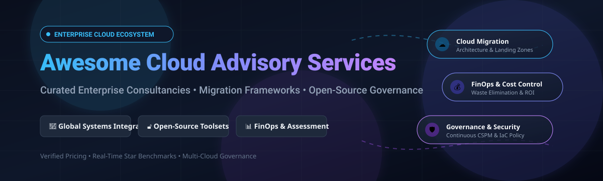

# Awesome Cloud Advisory Services 🏢 ☁️

  

  

  

  

  

  

  

---

## 🌟 Top Cloud Advisory Services Ecosystem

**Curated List of Commercial Cloud Consulting Firms & Open-Source Assessment/Governance Tools**  

*Focused on Cloud Migration Assessment, Landing Zone Design, Governance Automation, Cost Optimization & Self-Hosted Advisory Frameworks*

**Last updated: October 2026** 📅

---

### 📌 Overview & SEO Summary 🚀 🔍

Welcome to the definitive, curated directory of **cloud advisory services**, **enterprise cloud consulting**, **cloud migration assessment frameworks**, and **open-source cloud governance tools**. Whether evaluating tier-1 global systems integrators (such as *Accenture Cloud First*, *Deloitte Cloud*, *IBM Consulting*, and *PwC Cloud*) or production-grade open-source tools (such as *Trivy*, *Prowler*, *Infracost*, *Open Policy Agent*, *Checkov*, and *Cloud Custodian*), this repository benchmarks enterprise starting prices, free tier allowances, CSPM capabilities, and FinOps cost intelligence.

**Target Domains & Keywords:** cloud advisory services, cloud consulting firms, cloud migration assessment, AWS Well-Architected Framework, FinOps cost optimization, landing zone design, Cloud Security Posture Management (CSPM), Infrastructure as Code (IaC) governance, multi-cloud transformation, enterprise cloud modernization.

**Key Market Context:**

- **Gartner projects worldwide public cloud end-user spending to reach $723.4 billion in 2025**, with cloud consulting and implementation services representing a significant portion of that spend as enterprises accelerate migration and modernization.

- **ISG's 2026 Buyers Guides** consistently rank **Salesforce, Oracle, Microsoft, and HubSpot** as leaders across AI-enabled cloud platforms, while **Accenture, Deloitte, and IBM** dominate the enterprise advisory services market.

- **Cloud Custodian** is a **CNCF Incubating project** that supports AWS, Azure, GCP, Kubernetes, and OpenStack, using a YAML-based DSL for real-time policy enforcement and cost governance .

- **Prowler** is the **most widely used open-source cloud security platform**, with **572 AWS checks, 165 Azure checks, 100 GCP checks, and 83 Kubernetes checks**, covering **41+ compliance frameworks** including CIS, NIST 800-53, PCI-DSS, GDPR, HIPAA, and SOC2 .

- **Checkov** scans Terraform, CloudFormation, Kubernetes manifests, Helm charts, Dockerfiles, and ARM templates **without requiring cloud credentials** — catching misconfigurations before provisioning .

- **Infracost** generates **cloud cost estimates for Terraform in pull requests**, enabling shift-left FinOps for migration and modernization projects .

- **Komiser** is an **open-source cloud resource manager** that scans AWS, Azure, GCP, DigitalOcean, and Civo accounts, surfacing misconfigurations, underutilized infrastructure, and hidden cost drivers from a single dashboard .

- **OptScale** is an **open-source FinOps platform** from Hystax supporting AWS, Azure, GCP, Alibaba Cloud, and Kubernetes, with cost analytics, anomaly detection, rightsizing, and budget management .

- **Prophet** is an **open-source resource collection and analysis toolset** for cloud migration and disaster recovery pre-assessment, supporting physical machines and VMware environments .

- **ArchiQ** is an **AWS Labs sample** demonstrating Amazon Q-powered architecture analysis, generating security assessments, well-architected reviews, architecture diagrams, and modernization path analysis .

---

## 📑 Table of Contents

- [🏢 SaaS & Commercial Platforms](#-saas--commercial-platforms)

- [🔓 Open-Source GitHub Projects](#-open-source-github-projects)

- [🛠️ How to Contribute](#%EF%B8%8F-how-to-contribute)

- [📊 Star History](#-star-history)

- [🤝 Support & Sponsorship](#-support--sponsorship)

- [⚠️ Disclaimer](#%EF%B8%8F-disclaimer)

---

## 🏢 SaaS / Commercial Platforms 🌐 💼

> [!NOTE]
> **Market Size & Industry Structure:** The global cloud consulting and advisory services market is estimated at **$38–$45 Billion (2025–2026)** and projected to exceed **$120+ Billion by 2032** (growing at a ~17–20% CAGR), driven by enterprise GenAI adoption, large-scale cloud migrations, and FinOps governance. The sector is **moderately to highly fragmented** rather than a "winner-take-all" monopolistic market: while the top Tier-1 Global Systems Integrators (Accenture, Deloitte, IBM, PwC) capture roughly 35–45% of enterprise mega-deals, a vast long-tail of specialized cloud-native consultancies, boutique FinOps advisory agencies, and platform-specific partners thrives due to complex multi-cloud ecosystems and localized compliance demands.

The cloud advisory services market spans **global systems integrators** (Accenture, Deloitte, IBM) that provide **end-to-end migration, modernization, and managed services**, **cloud-native consultancies** (Slalom, Cloudreach) that focus on **practical implementation and enablement**, and **platform-specific advisory practices** (Salesforce, Cognizant, Wipro) that combine **deep platform expertise with industry specialization**. **Accenture Cloud First** represents a **$3 billion investment** in cloud capabilities . **Deloitte Cloud** integrates with **Deloitte’s industry practices and audit capabilities** .

| SaaS / Commercial Platform | Company / Owner | Company Size (Annual Revenue / Valuation) | Standard Edition Starting Price | Free Tier / Free Trial Limits | Description |

| :--- | :--- | :--- | :--- | :--- | :--- |

| **[Deloitte Cloud](https://www2.deloitte.com/)** 🟢 | Deloitte | **$70.5 Billion Revenue** (Private network) | **$175/hour** (Standard advisory starting rate card; cloud assessments from $25,000/engagement) | **30-day guided proof-of-concept / demo trial** (Includes architecture discovery session; no self-serve free forever plan) | **Enterprise cloud advisory** — **Strategy, migration, and governance with industry specialization** . **Integration with audit and risk practices** . **Best for regulated industries** . |

| **[Accenture Cloud First](https://www.accenture.com/)** 🎯 | Accenture | **$69.7 Billion Revenue** (~$126B Market Cap) | **$195/hour** (Foundation technical consultant rate; advisory packages from $50,000/project) | **30-day proof-of-concept / pilot trial** (Includes cloud maturity assessment workshop; no self-serve free forever tier) | **Global cloud transformation leader** — **$3 billion investment in cloud capabilities** . **Migration, modernization, and managed services at scale** . **Deep hyperscaler partnerships with AWS, Azure, and GCP** . |

| **[IBM Consulting](https://www.ibm.com/consulting)** 🔵 | IBM | **$67.5 Billion Revenue** (~$214B Market Cap) | **$160/hour** (IT specialist MAS rate; hybrid cloud advisory scopes from $30,000) | **Free forever IBM Cloud Lite tier** (Includes 256 MB Cloud Foundry memory, 40+ always-free services, and $200 credit valid for 30 days) | **Hybrid cloud and AI consulting** — **Deep expertise in Red Hat OpenShift, watsonx, and hybrid cloud architectures** . **Migration and modernization with AI governance** . |

| **[PwC Cloud](https://www.pwc.com/)** 🟤 | PwC | **$56.9 Billion Revenue** (Private network) | **$175/hour** (Advisory staff rate; cloud diagnostic & GRC reviews from $25,000) | **14-day cloud readiness assessment pilot** (Includes initial compliance gap review; no ongoing free plan) | **Cloud advisory with audit and risk integration** — **Strategy, governance, and compliance-focused cloud transformations** . |

| **[Salesforce Advisory Services](https://www.salesforce.com/)** ☁️ | Salesforce | **$41.5 Billion Revenue** (~$189B Market Cap) | **$25/user/month** (Starter Suite; Premier Advisory Success Plan at 30% of net license fees) | **30-day full-featured free trial** (Starter Suite free trial without credit card; permanent Trailhead & Architect sandbox tier) | **CRM-native advisory** — **Strategic guidance for Salesforce implementations, integrations, and AI adoption** . **Trailhead modules for self-guided learning** . **Best for Salesforce-centric transformations** . |

| **[Capgemini Cloud](https://www.capgemini.com/)** 🔴 | Capgemini | **€22.47 Billion Revenue** (~$24.5B / ~$20B Market Cap) | **$120/hour** (Cloud migration technical rate; assessment packages from $20,000) | **14-day cloud migration discovery assessment trial** (Includes cloud estate inventory scan; no permanent free tier) | **Cloud transformation and managed services** — **Migration, modernization, and cloud-native development** . **Strong European presence** . |

| **[Cognizant Cloud](https://www.cognizant.com/)** 🟡 | Cognizant | **$21.1 Billion Revenue** (~$27B Market Cap) | **$89/hour** (Standard blended consulting rate; cloud discovery scopes from $15,000) | **30-day cloud modernization pilot engagement** (Includes automated workload assessment; no self-serve free forever plan) | **Cloud infrastructure and operations** — **Managed cloud services with AIOps** . **24/7 global support** . |

| **[Infosys Cobalt](https://www.infosys.com/)** 🟦 | Infosys | **$19.2 Billion Revenue** (~$43B Market Cap) | **$95/hour** (Cobalt cloud engineering consultant rate; migration sprints from $20,000) | **Free forever Infosys Springboard platform** (Enterprise digital learning & Cobalt labs; 30-day proof-of-concept pilot) | **Cloud services suite** — **Enterprise cloud transformation with industry cloud solutions** . **Cobalt portfolio for multi-cloud management** . |

| **[Wipro Cloud](https://www.wipro.com/)** 🟠 | Wipro | **$10.8 Billion Revenue** (~$18B Market Cap) | **$85/hour** (Cloud infrastructure specialist rate; advisory workshops from $15,000) | **14-day cloud readiness & FinOps assessment trial** (Includes infrastructure cost audit report; no permanent free tier) | **Global IT and cloud services** — **Cloud infrastructure management and support** . **24/7 global delivery model** . |

| **[Slalom](https://www.slalom.com/)** 🟣 | Slalom | **~$2.5 Billion Revenue** (Privately held) | **$125/hour** (Consulting rate card starting tier; advisory sprints from $15,000) | **14-day cloud strategy discovery engagement** (Includes architecture roadmap review; no free forever tier) | **Cloud transformation consultancy** — **Strategy, migration, and optimization with a focus on practical implementation** . **Industry-focused advisory** . |

---

## 🔓 Open-Source GitHub Projects 🌟 🛠️

*Curated self-hosted cloud security scanners, migration assessment tools, policy engines, and FinOps platforms — sorted strictly by GitHub Star Count (Descending)* 📈

- **[Trivy](https://github.com/aquasecurity/trivy)**   
  **Comprehensive security scanner for containers, Kubernetes, IaC, and cloud environments**, Apache-2.0 licensed. **Scans AWS, Azure, and GCP accounts** for misconfigurations, sensitive data leaks, software vulnerabilities, and compliance drifts. **Fast, credential-free IaC scanning for Terraform and Dockerfiles** with CI/CD native integration. 🛡️

- **[Prowler](https://github.com/prowler-cloud/prowler)**   
  **Open-source cloud security assessment and compliance tool**, Apache-2.0 licensed. **572 AWS checks, 165 Azure checks, 100 GCP checks, and 83 Kubernetes checks** . **41+ compliance frameworks: CIS, NIST 800-53, NIST CSF, PCI-DSS, GDPR, HIPAA, SOC2, FedRAMP, AWS Well-Architected** . **CI/CD integration with SARIF output** . **The industry standard open-source CSPM platform** . 🔍

- **[Infracost](https://github.com/infracost/infracost)**   
  **Cloud cost estimates for Terraform in pull requests**, Apache-2.0 licensed. **Shift-left FinOps** — shows cost impact of infrastructure changes before deployment . **Supports AWS, Azure, GCP, and 1,000+ resources** . **CLI, GitHub Actions, GitLab CI, and VS Code extension** . 💰

- **[Open Policy Agent (OPA)](https://github.com/open-policy-agent/opa)**   
  **Open-source, general-purpose policy engine**, Apache-2.0 licensed. **CNCF Graduated project** enabling unified, context-aware policy enforcement across microservices, Kubernetes, cloud landing zones, CI/CD pipelines, and API gateways via Rego query language. 📜

- **[Checkov](https://github.com/bridgecrewio/checkov)**   
  **Static analysis for IaC**, Apache-2.0 licensed. **Scans Terraform, CloudFormation, Kubernetes manifests, Helm charts, Dockerfiles, ARM templates, Serverless Framework, OpenAPI specs, GitHub Actions workflows** . **No cloud credentials required** — catches misconfigurations before provisioning . 🔬

- **[Steampipe](https://github.com/turbot/steampipe)**   
  **Query live cloud APIs using standard SQL**, AGPL-3.0 licensed. **150+ plugins covering AWS, Azure, GCP, Kubernetes** . **No ETL pipeline or database setup required** . **Write queries to surface idle resources, underutilized instances, or spend patterns** . 🔗

- **[ScoutSuite](https://github.com/nccgroup/ScoutSuite)**   
  **Multi-cloud security auditing tool**, GPL-2.0 licensed. **Collects configuration data from cloud provider APIs and runs security checks against it** . **Identifies publicly accessible S3 buckets, overly permissive IAM policies, unencrypted databases, and security groups with open ports** . **Interactive HTML report keyed by service** . 🎯

- **[Cloud Custodian](https://github.com/cloud-custodian/cloud-custodian)**   
  **Rules engine for cloud security, cost optimization, and governance**, Apache-2.0 licensed. **CNCF Incubating project** supporting **AWS, Azure, GCP, Kubernetes, and OpenStack** . **YAML-based DSL** for real-time policy enforcement . **Schedule cloud "off hours" for specific apps or resources to reduce budget waste** . 🛡️

- **[ThreatMapper](https://github.com/deepfence/ThreatMapper)**   
  **Open-source cloud-native security observability and vulnerability management platform**, Apache-2.0 licensed. Automatically visualizes cloud infrastructure topologies, continuously scans containers, serverless apps, and virtual machines for vulnerabilities, exposed secrets, and compliance drift. 🗺️

- **[Terrascan](https://github.com/accurics/terrascan)**   
  **Static code analyzer for Infrastructure as Code (IaC)**, Apache-2.0 licensed. Features **500+ built-in policies written in Rego** to detect security vulnerabilities and compliance deviations across Terraform, Kubernetes manifests, Helm, and ARM templates prior to deployment. 🔍

- **[CISO Assistant](https://github.com/intuitem/ciso-assistant-community)**   
  **One-stop-shop GRC platform**, AGPL-3.0 licensed. **Supports 130+ global frameworks with automatic control mapping**, including ISO 27001, NIST CSF, SOC 2, CIS, PCI DSS, NIS2, DORA, GDPR, HIPAA, and CMMC . **Docker-based self-hosting** . 🏛️

- **[Security Monkey](https://github.com/Netflix/security_monkey)**   
  **Netflix's foundational cloud auditing engine**, Apache-2.0 licensed. Monitors AWS, GCP, and OpenStack configurations, detecting policy anomalies, unauthorized changes, and insecure network rules with historical change tracking. 🐵

- **[Komiser](https://github.com/tailwarden/komiser)**   
  **Cloud resource visibility and cost optimization**, Apache-2.0 licensed. **Scans AWS, Azure, GCP, DigitalOcean, Civo, and Kubernetes** . **Surfaces misconfigurations, underutilized infrastructure, and hidden cost drivers from a single dashboard** . 🔍

- **[KICS (Keeping Infrastructure as Code Secure)](https://github.com/Checkmarx/kics)**   
  **Open-source IaC scanning tool by Checkmarx**, Apache-2.0 licensed. **Supports Terraform, AWS CloudFormation, Ansible, Kubernetes** . **Detects misconfigurations, insecure coding patterns, and policy violations before deployment** with 2,000+ security queries. 🔬

- **[OptScale](https://github.com/hystax/optscale)**   
  **Open-source FinOps platform**, Apache-2.0 licensed. **Supports AWS, Azure, GCP, Alibaba Cloud, and Kubernetes** . **Cost analytics, anomaly detection, rightsizing recommendations, and budget management** . **Also covers MLOps / AI workload cost optimization** . 📊

- **[Repokid](https://github.com/Netflix/repokid)**   
  **Netflix's AWS IAM least-privilege advisor and automatic role right-sizing framework**, Apache-2.0 licensed. Analyzes Access Advisor data to continuously prune unused IAM permissions across enterprise cloud accounts without disrupting production traffic. 🔑

- **[Regula](https://github.com/fugue/regula)**   
  **Pre-deployment IaC policy and compliance checker**, Apache-2.0 licensed. Validates Terraform, CloudFormation, and Kubernetes manifests against CIS Benchmarks using Open Policy Agent (OPA) Rego rules. 📏

- **[Finala](https://github.com/similarweb/finala)**   
  **Open-source resource cloud scanner**, Apache-2.0 licensed. **Analyzes, discloses, presents, and notifies about wasteful and unused resources** . **The most focused open-source resource optimization scanner** . 🔎

- **[AWS Well-Architected IaC Analyzer](https://github.com/aws-samples/well-architected-iac-analyzer)**   
  **Evaluates infrastructure-as-code deployments for security vulnerabilities and reliability issues before runtime provisioning**, Apache-2.0 licensed. **AWS Labs sample for proactive architecture review** . 🔍

- **[Google Cloud Pricing Calculator](https://github.com/Cyclenerd/google-cloud-pricing-cost-calculator)**   
  **Calculate estimated monthly costs of Google Cloud Platform products and resources via YAML files and CLI program**, Apache-2.0 licensed. **Supports Linux, macOS, and Windows** . 💸

- **[Trackit](https://github.com/trackit/trackit)**   
  **Helps you understand and improve your use of AWS**, Apache-2.0 licensed. **Cost visibility and optimization recommendations** . **The most accessible open-source AWS cost advisor** . 📊

- **[Prophet](https://github.com/Cloud-Discovery/prophet)**   
  **Automated resource collection, analysis, and management toolset for cloud migration and disaster recovery**, open-source. **Supports comprehensive collection and analysis of physical machines and VMware environments** . **Visualized application topology canvas** . 🏗️

- **[ckia (cloud know it all)](https://github.com/brittandeyoung/ckia)**   
  **Open-source alternative to AWS Trusted Advisor**, open-source. **Makes proactive optimization recommendations for target cloud accounts** . 💡

- **[ArchiQ (Amazon Q Architecture Reviewer)](https://github.com/aws-samples/sample-q-architecture-reviewer)**   
  **Amazon Q-powered architecture analysis tool**, Apache-2.0 licensed. Four analysis modes: security assessment, well-architected review, architecture diagram generation, and modernization path analysis . 🤖

- **[Cloud Architect (AI Agent)](https://github.com/bmdietrich/agent-cloud-architect)**   
  **AI Cloud Architect with CLI and MCP availability**, open-source. **Scans projects, detects tech stacks, and provides architecture recommendations, diagrams, and deployment comparisons for AWS, GCP, or Azure** . 🏗️

- **[Cloud Migration MCP](https://github.com/chrishorne74/cloud-migration-mcp)**   
  **MCP server for cloud migration assessment, strategy, and planning**, open-source. **7 Rs Strategy Engine** recommends Rehost, Replatform, Repurchase, Refactor, Retire, Retain, or Relocate based on workload attributes with ROM cost estimation. 🚀

- **[well-architected-terraform (WAT)](https://github.com/ilijad1/well-architected-terraform)**   
  **Terraform plan analyzer for Well-Architected Framework**, open-source. **Analyzes Terraform plan JSON against AWS Well-Architected pillars (Security, Reliability, Cost, Sustainability)** with SARIF output. 📐

---

## 🛠️ How to Contribute

Contributions are welcome! Follow these steps to submit new cloud advisory platforms or open-source assessment/governance software:

1. 🍴 **Fork** the repository.

2. 📝 **Add/edit** entries in `README.md` maintaining table/list structure and formatting.

3. 🔗 Include project title, official website/GitHub link, exact Stars_Count, license, and brief description.

4. 🚀 Submit a **Pull Request** with a descriptive summary of your changes.

---

## 📊 Star History

---

## 🤝 Support & Sponsorship

If you find this cloud advisory services repository useful, please consider supporting the project:

- ⭐ **Star** this repository to increase visibility!

- 🔀 **Fork** and share with fellow cloud consultants, platform engineers, and open-source advocates.

- ☕ **Sponsor & Buy Me a Coffee**: Support ongoing open-source curation via the [GitHub Sponsor Dashboard](https://github.com/sponsors/ishandutta2007).

---

## ⚠️ Disclaimer

- This is a **community-curated** list — not exhaustive and not an endorsement. ℹ️

- **Cloud advisory services from global SIs (Accenture, Deloitte, IBM) require significant engagement commitments** — typical migration assessments range from **$50,000–$500,000+** depending on scope and complexity.

- **Open-source advisory tools (Cloud Custodian, Prowler, Checkov, Infracost) provide the assessment and governance layer** but **do not replace strategic advisory** — they automate discovery, compliance checking, and cost visibility, while human expertise drives architecture decisions and organizational change.

- **Always validate assessment findings, compliance mappings, and cost estimates with a proof-of-concept** before making migration or modernization decisions. 📊

---

  <b>Made with ❤️ for cloud consultants, platform engineers, and open-source advisory advocates.</b>

